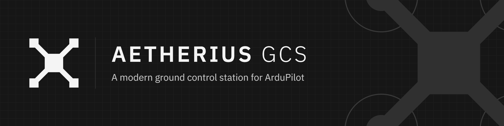
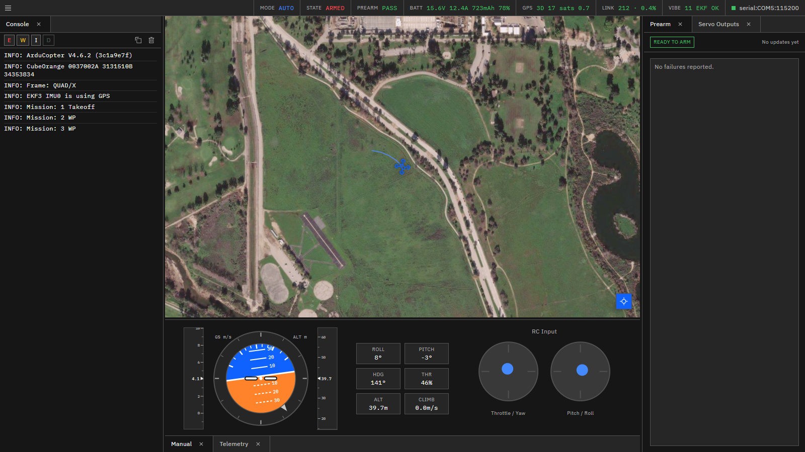
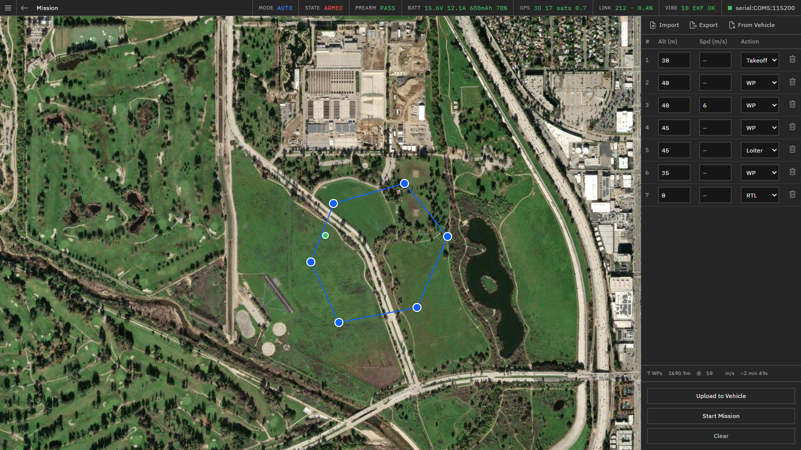
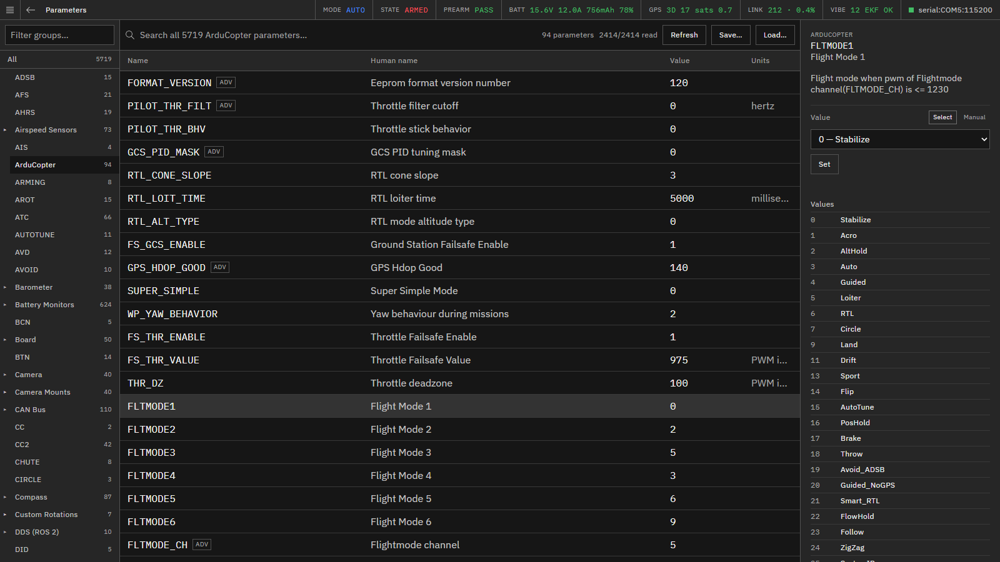
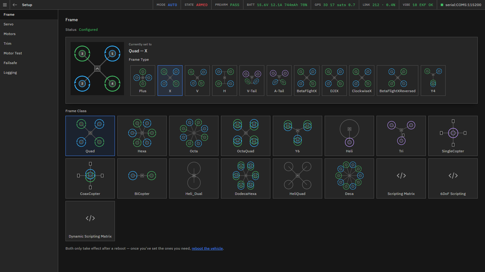
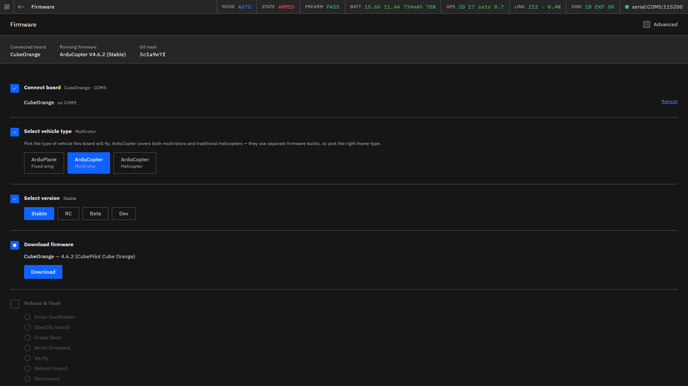
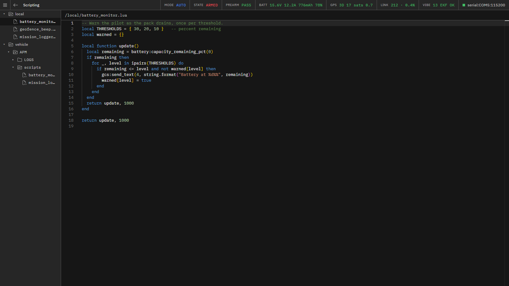
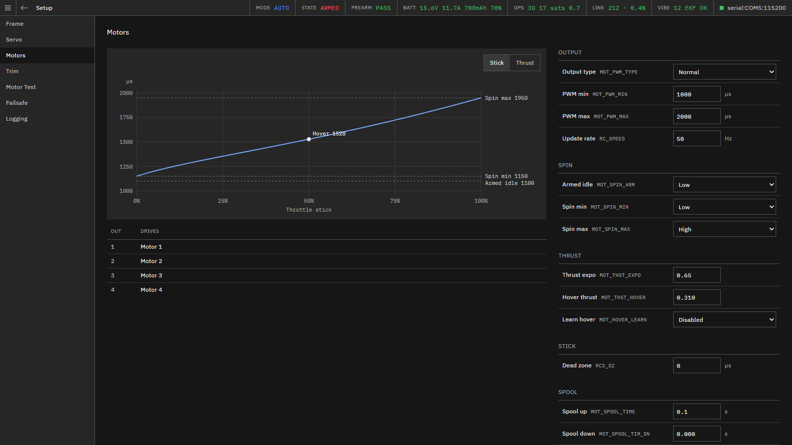

<p align="center">
  
</p>

A **Windows** ground control station for **ArduPlane** and **ArduCopter**, built with [Tauri](https://tauri.app) (Rust) and React.



| | |
|---|---|
|  **Mission** |  **Parameters** |
|  **Frame setup** |  **Firmware** |
|  **Lua scripting** |  **Motor setup** |

---

## Features

### Connection & Link Management
- **Serial, UDP, and TCP** MAVLink connections
- Auto-scans USB ports and recognises known ArduPilot boards (Pixhawk, SiK radios, RTK GPS receivers) by VID/PID
- SITL auto-detection for development without hardware
- Watchdog-backed link with graceful reconnect on drop; vehicle reboot with automatic reconnection

### Telemetry
Live vehicle state decoded from MAVLink and pushed to the UI at a configurable rate (1–20 Hz):
- Arm state, flight mode, GPS fix, battery, attitude, EKF status, vibration
- RSSI and packet-loss percentage, groundspeed, airspeed, climb rate
- Wind, nav cross-track error, waypoint distance

### Persistent Map Workspace
- **MapLibre GL** map stays visible throughout — panels dock or float around it, never replace it
- Animated vehicle marker (smooth 60 fps interpolation) that changes shape by vehicle type
- Vehicle track lines: grey for taxi (disarmed), blue for flight (armed)
- "Follow vehicle" mode with automatic centre-on-first-fix
- **US airspace overlays** — Class B/C/D/E polygons rendered from FAA shapefiles, per-class colour customisation

### Dockable Panel Workspace
Panels can be docked (left / right / bottom), floated, tabbed, resized, or closed. Layout is persisted across restarts.

| Panel | Description |
|---|---|
| **Telemetry** | Stat rows with optional sparklines; adapts for side vs bottom dock |
| **Console** | Live log/event feed with line coalescing (`×N` repeats) |
| **Prearm** | Vehicle prearm check results from ArduPilot, auto-refreshed |
| **Manual** | SVG primary flight display (attitude, heading) + RC channel bars |
| **RC Override** | RC channel override; floats only (never backgrounded while active) |
| **Mission** | Mission route overlay on the map |
| **Servo Outputs** | Live servo/motor output PWM per channel |
| **CLI** | Requests from `aetherius-cli`, to approve, reject or stop |
| **Checklist** | Your own checklists, ticked off as you go |

### Full-Screen Pages

| Page | Description |
|---|---|
| **Mission** | Upload, download and edit ArduPilot missions; numbered waypoints on the map |
| **Geofence** | Edit the fence and its breach action; upload and download |
| **Rally Points** | Edit, upload and download rally points |
| **Parameters** | Read and write vehicle parameters, searchable, with ArduPilot's own descriptions |
| **Setup** | Frame, servo outputs, motors, trim, motor test, failsafes, logging |
| **Calibration** | Accelerometer, gyroscope, level horizon, compass, radio, ESC (Copter) |
| **Scripting** | File tree of local scripts and the vehicle's (MAVLink FTP) with a Monaco editor for Lua |
| **Firmware** | Fetch the ArduPilot manifest, match to the connected board, flash via bootloader |
| **Logs** | Dataflash log download over MAVLink FTP |
| **Log Analysis** | Plot any logged field on a shared timeline |
| **SD Card** | Logs and scripts straight from an SD card or folder, no vehicle needed |
| **MAVLink Inspector** | Raw MAVLink traffic per message type, with rates and recent messages |
| **Settings** | Display mode, telemetry rate, airspace, sparklines, confirmation dialogs |
| **About** | Version info and manual update check |

### Command-Line Access
`aetherius-cli` lets scripts, AI agents and terminals read and set parameters, push Lua scripts, read the console and work with logs — always through the running app, with each request shown in the CLI panel. Off by default; see [CLI.md](CLI.md).

### Auto-Update
Checks GitHub Releases on launch via `tauri-plugin-updater` and prompts once per session.

---

## Tech Stack

| Layer | Technology |
|---|---|
| Desktop runtime | [Tauri v2](https://tauri.app) (Rust + WebView2) |
| MAVLink | [`mavlink` crate](https://docs.rs/mavlink) — ArduPilot Mega dialect |
| Serial I/O | [`serialport`](https://docs.rs/serialport) |
| Async runtime | [Tokio](https://tokio.rs) |
| Frontend framework | [React 19](https://react.dev) (TypeScript) |
| Build tool | [Vite 8](https://vitejs.dev) |
| Styling | [Tailwind CSS v4](https://tailwindcss.com), IBM Carbon design tokens |
| Icons | [`@carbon/icons-react`](https://carbondesignsystem.com/elements/icons/library/) |
| Map | [MapLibre GL 6](https://maplibre.org) |
| 3D views | [three.js](https://threejs.org) via [React Three Fiber](https://r3f.docs.pmnd.rs) (calibration) |
| Code editor | [Monaco Editor](https://microsoft.github.io/monaco-editor/) |
| Persistent settings | [`tauri-plugin-store`](https://github.com/tauri-apps/tauri-plugin-store) |

---

## Prerequisites

- **Node.js** 20+ and **npm**
- **Rust** toolchain (stable) — install via [rustup](https://rustup.rs)
- **Tauri prerequisites** — see the [Tauri v2 Windows setup guide](https://v2.tauri.app/start/prerequisites/); requires Visual Studio C++ build tools and WebView2 (pre-installed on Windows 11)

---

## Development

```bash
npm install
npm run tauri dev
```

This starts the Vite dev server on `localhost:1420` and the Tauri Rust backend together with hot-reload for the frontend.

**Frontend only** (no Tauri backend, useful for UI work in a browser):
```bash
npm run dev
```

Open `http://localhost:1420/?mock` to run against canned data instead of a backend: a connected, flying ArduCopter with parameters, a mission, Lua scripts and a firmware list (see `src/dev/mockBackend.ts`). Only in dev builds; the screenshots above were taken this way.

---

## Building for Release

```bash
npm run tauri build
```

Produces a platform installer under `src-tauri/target/release/bundle/`. The Rust release profile uses LTO, `opt-level = 3`, and binary stripping.

**Keep package.json and Cargo.toml versions in sync:**
```bash
npm run sync-version
```

---

## Airspace Data

US airspace overlays are pre-built from FAA shapefiles and committed to `public/`. To rebuild from source shapefiles (not normally needed):

```bash
npm run build:airspace
```

---

## Project Structure

```
src/                  React frontend
  components/         Top bar, connect control, arm/mode controls
  panels/             Dockable panels (telemetry, console, prearm, manual, mission, CLI…)
  pages/              Full-screen pages (mission, setup, calibration, params, scripting, firmware, logs…)
  lib/                State, hooks, business logic (vehicle, workspace, map, settings…)
  dev/                Mock backend for browser-only runs (`?mock`)
src-tauri/src/        Rust backend
  link.rs             Connection lifecycle, USB scan, MAVLink read loop, watchdog
  dispatch.rs         MAVLink message routing
  telemetry/          VehicleSnapshot and per-message telemetry handlers
  mission.rs          Mission upload/download (MAVLink mission protocol); fence.rs, rally.rs likewise
  params.rs           Parameter read/write
  scripting/          MAVLink FTP for Lua scripts
  firmware/           Manifest fetch + bootloader flashing
  logs/               Dataflash log download, parsing and analysis
  cli/                Local server behind aetherius-cli
src-tauri/cli/        The aetherius-cli binary
scripts/              Build utilities (airspace, CLI, motor layouts, version sync)
public/               Static assets, parameter reference, pre-built airspace GeoJSON
docs/screenshots/     README screenshots
```

---

## Related Docs

- [DESIGN.md](DESIGN.md) — architecture notes and design decisions
- [CLI.md](CLI.md) — `aetherius-cli` commands and how it connects to the app
- [ROADMAP.md](ROADMAP.md) — planned work
